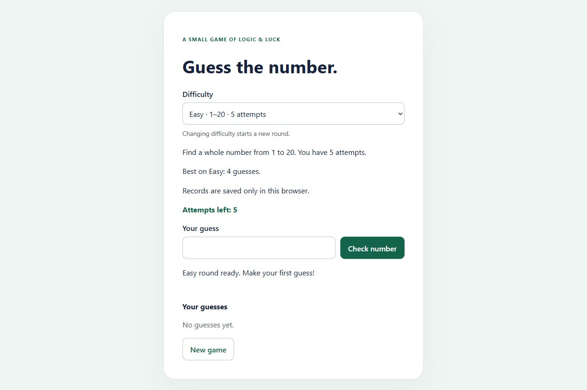

# Guess the Number

A small number-guessing game built with HTML, CSS, and vanilla JavaScript. Find a secret whole number from **1 to 20** in **five attempts**, using higher/lower hints.

## Preview



## Rules

- Each round chooses a random integer from 1 to 20, including both endpoints.
- Each valid, new guess uses one attempt.
- Empty, fractional, out-of-range, and repeated guesses do not use attempts.
- A wrong guess tells you whether to try a higher or lower number.
- A correct guess wins, including on the fifth attempt.
- Five incorrect guesses end the round and reveal the number.
- Input and submission are disabled after a win or loss.
- **New game** resets the round and chooses a fresh random number. The same number may occur again by chance.

## Run locally

1. Download the repository through **Code → Download ZIP** and extract it, or clone it:

   ```sh
   git clone https://github.com/Shariatypour/Guess-the-Number.git
   cd Guess-the-Number
   ```

2. Open `index.html` in your browser. Keep the `css` and `js` folders beside it.
3. Optionally, serve the folder with VS Code's Live Server extension.

No dependencies, build step, API keys, or backend are needed.

## Controls and accessibility

| Control | Action |
| --- | --- |
| Number input | Enter a whole number from 1 to 20 |
| Check number / Enter in the input | Submit a guess |
| Tab / Shift + Tab | Navigate enabled controls |
| Enter / Space on a focused button | Activate the button |
| New game | Reset attempts, history, input, and game status |

The input has a visible label, invalid values receive `aria-invalid`, and feedback uses a status region. When the round ends, focus moves to **New game**; starting a new round returns focus to the input.

## How it works

The game stores four pieces of state:

- `secretNumber`: the number to find.
- `attemptsLeft`: the remaining guesses.
- `guesses`: the accepted guesses for this round.
- `gameOver`: whether the round has ended.

A random number is generated with:

```js
Math.floor(Math.random() * (maximum - minimum + 1)) + minimum
```

Input validation runs **before** adding a guess or reducing attempts. The win check runs **before** the zero-attempt check so a correct final guess still wins. `updateDisplay()` keeps the controls and visible state synchronized; `newGame()` restores the initial state.

All game state exists in the browser. Refreshing the page starts a new round; no progress is saved or submitted to a server. This is a learning game, not a tamper-resistant competition.

## Project structure

```text
Guess-the-Number/
├── index.html       # Rules, labeled form, feedback, and history
├── css/style.css    # Responsive layout and focus styles
├── js/script.js     # Random number, validation, outcomes, and reset
└── docs/preview.png # Screenshot of the initial game
```

## Validation

Controlled logic checks covered empty/invalid/repeated input, higher/lower hints, normal and fifth-attempt wins, loss, submissions after completion, reset, and random endpoints 1 and 20.

Browser checks covered Enter submission, empty and repeated guesses, a winning round using visible hints, a five-guess losing round, disabled controls at completion, keyboard restart, and a 320px layout without horizontal overflow. No warning/error logs were recorded during these checks.

A screen-reader speech audit and a complete browser/device compatibility audit have not been performed.

## Project status

See [pull request #1](https://github.com/Shariatypour/Guess-the-Number/pull/1) for the implementation and validation history. A public live demo has not been published.
